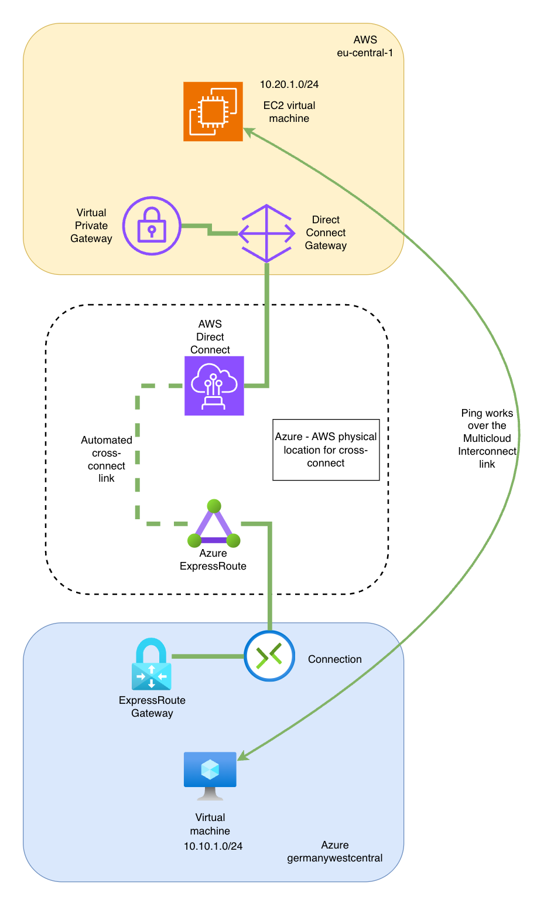

# AWS to Azure private connectivity with AWS Interconnect - multicloud

Terraform lab that builds a private, dedicated connection between an AWS VPC and an Azure VNET using **AWS Interconnect - multicloud** and **Azure Multicloud Interconnect** (both in public preview), with one small Ubuntu VM on each side to test end-to-end reachability.

No VPN tunnels, no colocation, no third-party network provider.

## Architecture



Address space used in the lab:

| | AWS (eu-central-1) | Azure (germanywestcentral) |
|---|---|---|
| Network | VPC `10.20.0.0/16` | VNET `10.10.0.0/16` |
| VM subnet | `10.20.1.0/24` | `10.10.1.0/24` |
| Gateway subnet | - | `GatewaySubnet` `10.10.255.0/27` |

## What gets created

| File | Contents |
|---|---|
| `azure.tf` | Resource group, VNET, subnet, NSG, public IP, Ubuntu 24.04 VM |
| `aws.tf` | VPC, subnet, internet gateway, route table, security group, key pair, Ubuntu 24.04 VM |
| `interconnect.tf` | Azure Multicloud Interconnect circuit, AWS Direct Connect gateway, AWS Interconnect connection, Azure ExpressRoute gateway + connection, AWS virtual private gateway + association + route propagation |
| `providers.tf` | `azurerm`, `azapi`, `aws`, `awscc` |
| `variables.tf` | Regions, VM sizes, ASNs, address space |
| `outputs.tf` | IPs, interconnect state, ready-made SSH and ping commands |

Two extra providers are needed because the main ones do not support the service yet:

- `azapi` creates the ExpressRoute circuit, because `azurerm_express_route_circuit` has no arguments for the partner account ID or the activation key.
- `awscc` creates the AWS Interconnect connection, because the `aws` provider has no interconnect resource yet ([tracking issue](https://github.com/hashicorp/terraform-provider-aws/issues/47458)).

## How the two sides are paired

The connection is Azure-initiated and needs no manual copy-paste:

1. The Azure circuit is created with `partnerAccountId` set to your AWS account ID (looked up automatically).
2. Azure generates an activation key, which Terraform reads back from the circuit.
3. That key is passed straight into `awscc_interconnect_connection`, which redeems it on the AWS side.

All of this happens within a single `terraform apply`.

## Prerequisites

- An **Azure subscription** and an **AWS account**, with permissions to create networking and compute resources
- [Terraform](https://developer.hashicorp.com/terraform/install) 1.5 or newer
- [Azure CLI](https://learn.microsoft.com/cli/azure/install-azure-cli), logged in with `az login`
- [AWS CLI](https://docs.aws.amazon.com/cli/latest/userguide/getting-started-install.html), configured with credentials (`aws configure` or SSO)
- An **RSA** SSH key pair at `~/.ssh/id_rsa` / `~/.ssh/id_rsa.pub` (Azure Linux VMs only accept RSA keys). Create one with `ssh-keygen -t rsa -b 4096` if needed, or point `ssh_public_key_path` to another key.

### Preview limitations to be aware of

- Supported region pairs are limited. This lab uses **AWS eu-central-1 <-> Azure Germany West Central**. The other Azure regions in the preview are East US, West US and Australia East.
- Bandwidth is fixed at **1 Gbps**.
- **One** interconnect per AWS region per account, and one gateway connection per Azure interconnect.
- No SLA. AWS states that preview connections are removed ahead of general availability.

## Step 1 - Get the code

```bash
git clone https://github.com/vadaszgergo/terraform-public.git
cd terraform-public/aws-azure-multicloud-interconnect
```

## Step 2 - Select the accounts

Make sure both CLIs point to the subscription and account you want to deploy into:

```bash
az account show --query '{name:name, id:id}'
aws sts get-caller-identity
```

Switch the Azure subscription with `az account set --subscription <id>` if needed.

The `azurerm` provider (version 4 and newer) needs the subscription ID passed explicitly. Export it in every new shell before running Terraform:

```bash
export ARM_SUBSCRIPTION_ID=$(az account show --query id -o tsv)
```

## Step 3 - Set your variables

Create a `terraform.tfvars` file that restricts SSH to your own public IP:

```bash
echo "my_ssh_source_cidr = \"$(curl -s https://checkip.amazonaws.com)/32\"" > terraform.tfvars
```

Alternatively, copy `terraform.tfvars.example` to `terraform.tfvars` and edit it by hand.

If you skip this, SSH is open to `0.0.0.0/0`. `terraform.tfvars` is listed in `.gitignore`, so your IP stays out of version control.

Optional overrides, all with defaults in `variables.tf`:

| Variable | Default | Notes |
|---|---|---|
| `prefix` | `awsazure` | Used in all resource names |
| `azure_location` | `germanywestcentral` | Must pair with `aws_region` |
| `aws_region` | `eu-central-1` | Must pair with `azure_location` |
| `interconnect_peering_location` | `germanywc` | Azure's name for the interconnect location |
| `azure_vm_size` | `Standard_D2as_v4` | See the note on quotas below |
| `aws_instance_type` | `t3.micro` | |
| `azure_ergw_sku` | `ErGw1AZ` | |
| `ssh_public_key_path` | `~/.ssh/id_rsa.pub` | |

**Azure VM size and quotas:** the default is `Standard_D2as_v4` because the cheaper B-series sizes had no quota or availability on the subscription this lab was built on. If your subscription has B-series quota in the region, a smaller size such as `Standard_B2ts_v2` is cheaper. Check with:

```bash
az vm list-usage -l germanywestcentral -o table | grep -i "BS"
```

## Step 4 - Deploy

```bash
terraform init
terraform plan
terraform apply
```

Expect the apply to take **30-45 minutes**. Almost all of that is the Azure ExpressRoute gateway; the interconnect itself comes up in a few minutes (the Azure side takes a little longer than the AWS side).

## Step 5 - Verify the interconnect

```bash
# AWS side - should print "available"
terraform output interconnect_aws_state

# Azure side - should print "Provisioned"
az network express-route show \
  -g awsazure-rg -n awsazure-interconnect \
  --query serviceProviderProvisioningState -o tsv
```

If the AWS state still shows `pending`, run `terraform refresh` after a few minutes and check again.

Check that routes were exchanged:

```bash
# AWS: the subnet route table should contain 10.10.0.0/16, propagated from the virtual private gateway
aws ec2 describe-route-tables --region eu-central-1 \
  --filters "Name=tag:Name,Values=awsazure-vm-rt" \
  --query 'RouteTables[0].Routes[].{dest:DestinationCidrBlock,gw:GatewayId,origin:Origin}' -o table

# Azure: the VM NIC should have an effective route for 10.20.0.0/16 via the ExpressRoute gateway
az network nic show-effective-route-table \
  -g awsazure-rg -n awsazure-vm-nic -o table
```

## Step 6 - Test end to end

Terraform prints ready-made commands:

```bash
terraform output ssh_commands
terraform output ping_tests
```

SSH into each VM and ping the private IP of the other:

```bash
# Azure VM (user: azureuser) -> AWS VM
ping -c 3 <aws_vm_private_ip>

# AWS VM (user: ubuntu) -> Azure VM
ping -c 3 <azure_vm_private_ip>
```

Both security groups already allow all traffic from the other cloud's address space, so the pings should succeed as soon as the routes are in place.

## Step 7 - Clean up

```bash
terraform destroy
```

The destroy also takes a while because of the ExpressRoute gateway. Do not leave the lab running unattended - see costs below.

**Expect to run it twice.** The first destroy removes everything except the Azure circuit and its resource group, and ends with this error on the circuit:

```
ConflictError: The current operation could not be executed because it is already in progress.
```

Azure is still deprovisioning its side of the interconnect when Terraform tries to delete the circuit. Wait a few minutes, then run `terraform destroy` again to remove the last two resources. Nothing billable is left in between - the circuit is free during the preview.

## Costs

- **Interconnect:** no charge on either side during the preview.
- **Azure ExpressRoute gateway:** billed per hour for as long as it exists. This is the main cost of the lab.
- **VMs and public IPs:** billed per hour on both sides.
- **AWS Direct Connect gateway and virtual private gateway:** no charge.

Check current pricing before deploying, and destroy the lab when you are done.

## Troubleshooting

| Symptom | Likely cause |
|---|---|
| `subscription ID could not be determined` | `ARM_SUBSCRIPTION_ID` is not exported in the current shell (Step 2) |
| `exceeding approved ... Cores quota` on the Azure VM | No quota for that VM family in the region. Pick another `azure_vm_size` or request a quota increase |
| AWS connection fails for lack of an activation key | The key was not yet available when the circuit was created. Run `terraform apply` again |
| Azure circuit ends up in a `Failed` state | The subscription may not be enabled for the preview in that region. See the [Azure Multicloud Interconnect docs](https://learn.microsoft.com/azure/multicloud-interconnect/overview) |
| `terraform destroy` fails on the circuit with `ConflictError ... already in progress` | Expected on the first run. Run `terraform destroy` a second time (Step 7) |
| Interconnect is up but pings fail | Check both route tables (Step 5). On AWS, route propagation must be enabled on the subnet route table; on Azure, the gateway connection must be in a `Connected` state |
| Private peering shows as `Disabled` on the Azure circuit | Expected. The peering is managed by the service and does not appear as a normal ExpressRoute private peering |

## Notes

- `terraform.tfstate` contains the activation key in plain text. Do not commit state files or `terraform.tfvars` to a public repository.
- Both ASNs (`aws_dxgw_asn`, `aws_vgw_asn`) must stay outside 65515-65520, which Microsoft reserves.
- A virtual private gateway is used on the AWS side because it is free and enough for a single VPC. For several VPCs, attach the Direct Connect gateway to a Transit Gateway instead.

## References

- [AWS Interconnect - multicloud: getting started](https://docs.aws.amazon.com/interconnect/latest/userguide/getting-started-multicloud.html)
- [What is Azure Multicloud Interconnect Preview?](https://learn.microsoft.com/azure/multicloud-interconnect/overview)
- [Azure Multicloud Interconnect availability and limits](https://learn.microsoft.com/azure/multicloud-interconnect/availability-limits)
- [AWS::Interconnect::Connection resource reference](https://docs.aws.amazon.com/AWSCloudFormation/latest/TemplateReference/aws-resource-interconnect-connection.html)
