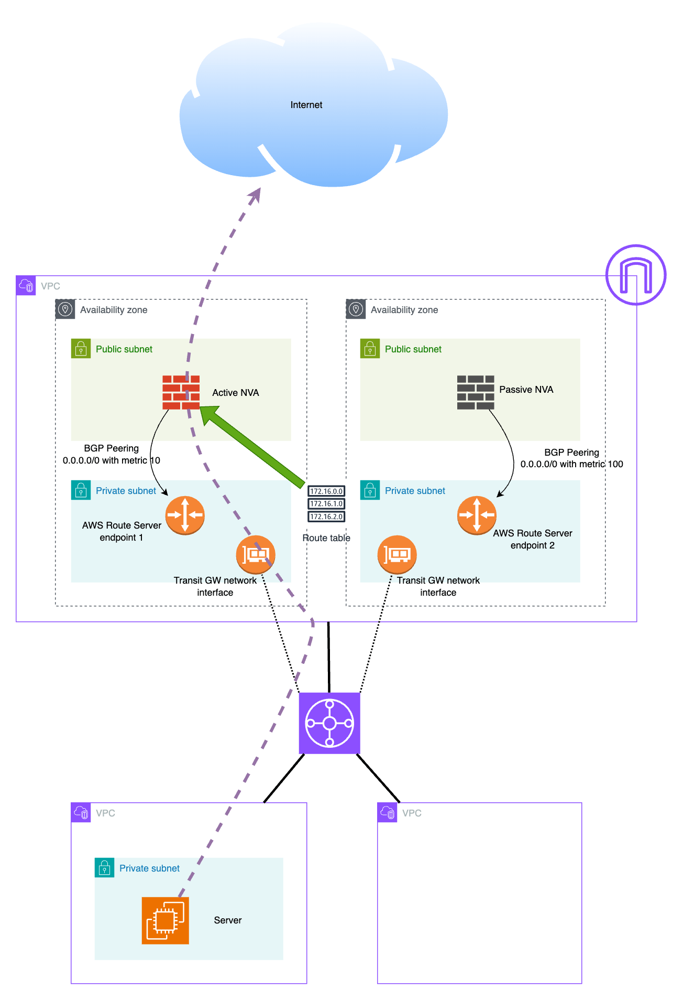

# AWS Route Server for NVA Failover Lab

This Terraform lab demonstrates outbound internet failover from a workload VPC through two NVA routers using Amazon VPC Route Server and BGP.

## Topology Summary

- Region: `eu-central-1`
- Hub VPC: `10.0.0.0/16`
- Workload VPC: `192.168.0.0/16`
- Transit Gateway between both VPCs
- Route Server in Hub VPC with two endpoints
- Two Ubuntu NVAs in public hub subnets, both doing NAT
- One Ubuntu workload VM in workload subnet

## Architecture Diagram



## What Terraform Deploys

### Hub VPC (`hub-vpc.tf`)
- Public NVA subnet 1: `10.0.0.0/24` (AZ[0])
- Public NVA subnet 2: `10.0.1.0/24` (AZ[1])
- Private TGW/Route-Server subnet 1: `10.0.10.0/24` (AZ[0])
- Private TGW/Route-Server subnet 2: `10.0.11.0/24` (AZ[1])
- Internet Gateway
- Public NVA route table:
  - `0.0.0.0/0 -> IGW`
  - `192.168.0.0/16 -> TGW` (separate `aws_route` resource)
- Private route table for TGW-side traffic

### Route Server (`route-server.tf`)
- Route Server ASN: `65000`
- VPC association to Hub VPC
- Route propagation enabled to `hub_private_tgw` route table
- Endpoints:
  - `hub_private_subnet01`
  - `hub_private_subnet02`
- Peer 1 to NVA1 private IP
- Peer 2 to NVA2 private IP
- Peer liveness: `bgp-keepalive`

### Transit Gateway (`tgw.tf`)
- TGW + dedicated TGW route table
- Hub VPC attachment uses both private hub subnets (`10.0.10.0/24`, `10.0.11.0/24`)
- Workload VPC attachment uses workload subnet (`192.168.0.0/24`)
- TGW routes:
  - `0.0.0.0/0 -> hub attachment`
  - `10.0.0.0/16 -> hub attachment`
  - `192.168.0.0/16 -> workload attachment`

### Workload VPC (`workload-vpc.tf`)
- Workload subnet: `192.168.0.0/24`
- Workload route table:
  - `0.0.0.0/0 -> TGW`

### EC2 + FRR + NAT (`ec2-nva-workload.tf`)
- Key pair from `~/.ssh/id_rsa.pub`
- 2x NVA Ubuntu `t3.nano` in public subnets
  - Public IP enabled
  - `source_dest_check = false`
  - `net.ipv4.ip_forward=1`
  - iptables MASQUERADE NAT enabled and persisted
  - FRR installed/configured
- 1x Workload Ubuntu `t3.nano` in workload subnet

## Current BGP Behavior (as configured)

On each NVA:
- eBGP to Route Server endpoint
- `ebgp-multihop 2`
- `disable-connected-check`
- `ip nht resolve-via-default`
- `network 0.0.0.0/0` advertised
- Inbound route-map: `RS-IN deny 10` (accept nothing inbound from Route Server)
- Outbound route-map `RS-OUT` on default prefix sets metric:
  - NVA1 metric `10`
  - NVA2 metric `100`

## Deploy

```bash
cd aws-route-server
terraform init
terraform plan
terraform apply
```

## Example Apply Output

```text
Apply complete! Resources: 42 added, 0 changed, 0 destroyed.

Outputs:

nva01_public_ip = "3.75.170.86"
nva02_public_ip = "3.67.79.244"
route_server_endpoint_subnet01_ip = "10.0.10.37"
route_server_endpoint_subnet02_ip = "10.0.11.26"
route_server_id = "rs-02d3471e5b9146c74"
transit_gateway_id = "tgw-038769faa873d41e0"
workload_private_ip = "192.168.0.153"
```

## Access the Workload VM (Jump via NVA1)

```bash
ssh -i ~/.ssh/id_rsa -J ubuntu@<NVA02_PUBLIC_IP> ubuntu@<WORKLOAD_PRIVATE_IP>
```

## Basic Validation

From workload VM:

```bash
ping -c 3 8.8.8.8
curl icanhazip.com
```

From NVA:

```bash
sudo vtysh -c "show ip bgp summary"
sudo vtysh -c "show bgp ipv4 unicast neighbors <route-server-endpoint-ip> advertised-routes json"
```

## Failover Demo Idea

1. Start continuous ping from workload VM to internet.
2. Stop `nva01` in AWS Console.
3. Observe BGP convergence and traffic resume through `nva02`.

## Notes

- This is a demo/lab setup, not production hardening.
- `user_data` changes require NVA recreation for deterministic re-apply.
- Resources are split by function for readability:
  - `main.tf`, `hub-vpc.tf`, `route-server.tf`, `tgw.tf`, `workload-vpc.tf`, `ec2-nva-workload.tf`, `outputs.tf`
