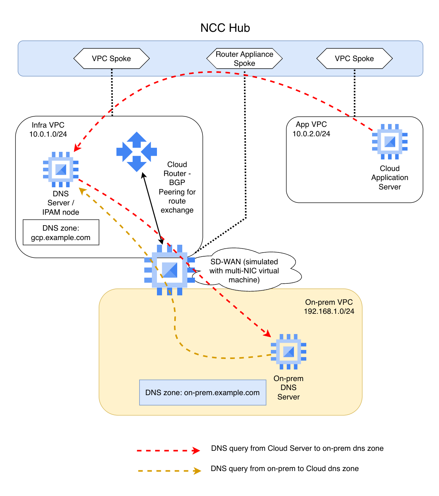

# Enterprise DNS with GCP Network Connectivity Center (NCC)

A complete Terraform lab that demonstrates how to set up hybrid DNS between on-premises infrastructure and Google Cloud when **Cloud DNS forwarding to on-prem is not allowed** due to its use of Google public source IPs (`35.199.192.0/19`).

Instead, a DNS VM (BIND) acts as the bridge between GCP and on-prem DNS, ensuring all queries toward on-prem originate from a private RFC1918 address. This is a common pattern in enterprises using IPAM solutions like Infoblox, BlueCat, or EfficientIP.

## The Problem

Cloud DNS can forward queries to on-prem name servers, but the source IP of those queries comes from `35.199.192.0/19` — a Google-owned public range. Many enterprise security teams block this because their internal DNS servers sit in a trusted zone that does not accept queries from public IPs.

## The Solution

Place a DNS VM (running BIND, or in production an IPAM grid member) inside GCP. Use Cloud DNS **peering** and **forwarding** to route queries to this VM, which then talks to on-prem using its own private IP.

When NCC connects multiple VPCs, the DNS configuration requires a specific chain:

1. **Application VPC**: Cloud DNS peering zone -> Infra VPC
2. **Infra VPC**: Cloud DNS forwarding zone -> DNS VM (BIND)
3. **DNS VM**: Forwards to on-prem DNS via the SD-WAN path

This avoids the public IP issue while keeping all DNS resolution transparent to application workloads.

## Architecture



```
                       ┌────────────────────────────────-──┐
                       │         NCC Hub (full mesh)       │
                       └──┬──────────────┬──────────────┬──┘
                          │              │              │
                     Infra VPC       App VPC      SD-WAN Router
                       Spoke          Spoke      Appliance Spoke
                          │              │              │
    ┌─────────────────────┴───┐          │              │
    │                         │    ┌─────┴────────────┐ │
    │      Infra VPC          │    │                  │ │
    │     10.0.1.0/24         │    │    App VPC       │ │
    │                         │    │  10.0.2.0/24     │ │
    │  ┌───────────────────┐  │    │                  │ │
    │  │     DNS VM        │  │    │  ┌────────────┐  │ │
    │  │     (BIND)        │  │    │  │   App VM   │  │ │
    │  │    10.0.1.10      │  │    │  │  10.0.2.10 │  │ │
    │  └───────────────────┘  │    │  └────────────┘  │ │
    │                         │    │                  │ │
    │  ┌───────────────────┐  │    └──────────────────┘ │
    │  │    SD-WAN VM      │◄─┼─────────────────────────┘
    │  │     (FRR)         │  │
    │  │  NIC0: 10.0.1.20  │  │  BGP: ASN 64515 <--> 64514
    │  │                   │  │        (NCC Cloud Router
    │  │  Cloud Router:    │  │         10.0.1.100/.101)
    │  │   10.0.1.100      │  │
    │  │   10.0.1.101      │  │
    │  └─────────┬─────────┘  │
    │            │            │
    └────────────┼────────────┘
                 │
                 │ NIC1: 192.168.1.20
                 │ (simulated WAN link)
                 │
    ┌────────────┴────────────┐
    │                         │
    │    On-Prem VPC          │
    │   192.168.1.0/24        │
    │   (simulated)           │
    │                         │
    │  ┌───────────────────┐  │
    │  │  On-Prem DNS      │  │
    │  │    (BIND)         │  │
    │  │  192.168.1.10     │  │
    │  └───────────────────┘  │
    │                         │
    └─────────────────────────┘
```

## DNS Flow

### GCP to On-Prem (`on-prem.example.com`)

```
App VM (10.0.2.10)
  │
  │ dig app1.on-prem.example.com
  │
  ▼
Cloud DNS (169.254.169.254)
  │
  │ DNS peering zone (app-vpc -> infra-vpc)
  │
  ▼
Cloud DNS (infra-vpc context)
  │
  │ DNS forwarding zone -> 10.0.1.10
  │ Source IP: 35.199.192.0/19 (but stays within GCP!)
  │
  ▼
DNS VM - BIND (10.0.1.10)
  │
  │ Forward to 192.168.1.10
  │ Source IP: 10.0.1.10  <-- private IP, on-prem security team is happy
  │ Path: via SD-WAN VM (NCC router appliance, BGP-learned route)
  │
  ▼
On-Prem DNS (192.168.1.10)
  │
  │ Authoritative response: app1 -> 192.168.1.50
  │
  ▼
Response travels back the same path
```

### On-Prem to GCP (`gcp.example.com`)

```
On-Prem Client
  │
  │ dig app-server.gcp.example.com
  │
  ▼
On-Prem DNS (192.168.1.10)
  │
  │ Forward gcp.example.com to 10.0.1.10
  │ Path: via SD-WAN VM (static route in on-prem VPC)
  │
  ▼
DNS VM - BIND (10.0.1.10)
  │
  │ Forward to Cloud DNS (169.254.169.254)
  │
  ▼
Cloud DNS (infra-vpc)
  │
  │ Resolves from private zone gcp.example.com
  │ Response: app-server -> 10.0.2.10
  │
  ▼
Response travels back the same path
```

## Key Components

| Resource | Purpose |
|----------|---------|
| **NCC Hub** | Central hub connecting all network spokes (full mesh) |
| **Infra VPC Spoke** | Hosts DNS VM and SD-WAN appliance |
| **App VPC Spoke** | Hosts application workloads |
| **SD-WAN Router Appliance Spoke** | Advertises on-prem routes to NCC via BGP |
| **DNS VM (BIND)** | Bridge between Cloud DNS and on-prem DNS |
| **SD-WAN VM (FRR)** | Simulates SD-WAN appliance with BGP (ASN 64515 <-> 64514) |
| **On-Prem DNS VM (BIND)** | Authoritative DNS for on-prem.example.com |
| **Cloud DNS peering zone** | Routes on-prem queries from App VPC to Infra VPC |
| **Cloud DNS forwarding zone** | Routes on-prem queries from Infra VPC to DNS VM |
| **Cloud DNS private zone** | Authoritative for gcp.example.com |

## Prerequisites

- A GCP project with billing enabled
- `gcloud` CLI authenticated
- Terraform >= 1.5
- APIs enabled (Terraform handles this): Compute, DNS, Network Connectivity

## Deployment

```bash
cp terraform.tfvars.example terraform.tfvars
# Edit terraform.tfvars with your project ID

terraform init
terraform plan
terraform apply
```

Wait 2-3 minutes after apply for VM startup scripts to complete.

## Test Scenarios

### Test 1: GCP to On-Prem DNS Resolution

Verifies the full DNS chain: Cloud DNS peering -> forwarding -> BIND -> on-prem DNS.

```bash
gcloud compute ssh app-vm --zone=europe-west1-b --tunnel-through-iap

dig app1.on-prem.example.com    # Expected: 192.168.1.50
dig db1.on-prem.example.com     # Expected: 192.168.1.51
dig web1.on-prem.example.com    # Expected: 192.168.1.52
dig mail.on-prem.example.com    # Expected: 192.168.1.53
```

### Test 2: GCP Internal DNS Resolution

Verifies Cloud DNS private zone works from the App VPC.

```bash
# Still on app-vm:
dig app-server.gcp.example.com  # Expected: 10.0.2.10
dig dns-server.gcp.example.com  # Expected: 10.0.1.10
```

### Test 3: On-Prem to GCP DNS Resolution

Verifies on-prem can resolve GCP records via the DNS VM bridge.

```bash
gcloud compute ssh onprem-dns-vm --zone=europe-west1-b --tunnel-through-iap

dig app-server.gcp.example.com @localhost  # Expected: 10.0.2.10
dig dns-server.gcp.example.com @localhost  # Expected: 10.0.1.10
```

### Test 4: DNS VM as the Bridge

Verifies the DNS VM can resolve in both directions.

```bash
gcloud compute ssh dns-vm --zone=europe-west1-b --tunnel-through-iap

# To on-prem (via SD-WAN path):
dig app1.on-prem.example.com @localhost       # Expected: 192.168.1.50

# To GCP (via Cloud DNS metadata server):
dig app-server.gcp.example.com @localhost      # Expected: 10.0.2.10
```

### Test 5: BGP and NCC Routing

Verifies the SD-WAN VM is advertising on-prem routes to NCC.

```bash
gcloud compute ssh sdwan-vm --zone=europe-west1-b --tunnel-through-iap

# BGP sessions should be Established with PfxSnt: 1
sudo vtysh -c "show bgp summary"

# Should show 192.168.1.0/24 as advertised
sudo vtysh -c "show ip bgp"
```

From your local machine, verify Cloud Router learned the route:

```bash
gcloud compute routers get-status ncc-router \
  --region=europe-west1 \
  --format="json(result.bgpPeerStatus[].name,result.bgpPeerStatus[].numLearnedRoutes,result.bgpPeerStatus[].state)"
```

### Test 6: Cross-VPC Connectivity via NCC

Verifies NCC route exchange enables cross-VPC communication.

```bash
# From dns-vm:
ping -c 2 10.0.2.10    # App VM (cross-VPC via NCC)
ping -c 2 192.168.1.10  # On-prem DNS (via SD-WAN/NCC)

# From app-vm:
ping -c 2 10.0.1.10    # DNS VM (cross-VPC via NCC)
```

### Test 7: Verify the DNS Source IP

This is the whole point of the setup. On the on-prem DNS VM, check what source IP DNS queries arrive from.

```bash
gcloud compute ssh onprem-dns-vm --zone=europe-west1-b --tunnel-through-iap

# Watch incoming DNS queries:
sudo tcpdump -n -i ens4 port 53

# Then from another terminal, trigger a query from app-vm:
# dig app1.on-prem.example.com
#
# You should see the query arriving from 10.0.1.10 (DNS VM),
# NOT from 35.199.192.0/19 (Google public range).
```

## DNS Zones Summary

| Zone | Type | Location | Purpose |
|------|------|----------|---------|
| `on-prem.example.com` | Peering | App VPC -> Infra VPC | Redirect queries to Infra VPC |
| `on-prem.example.com` | Forwarding | Infra VPC -> DNS VM | Forward to BIND at 10.0.1.10 |
| `on-prem.example.com` | Authoritative | On-Prem DNS VM | Master zone with test records |
| `gcp.example.com` | Private | Infra + App VPCs | Cloud DNS authoritative zone |
| `gcp.example.com` | Forwarding | On-Prem DNS VM | BIND forwards to DNS VM |

## Important Notes

- **FRR `no bgp ebgp-requires-policy`**: FRR 8.x+ blocks eBGP route exchange by default unless an explicit route-map is configured. The SD-WAN VM startup script disables this requirement for simplicity. In production, use proper route-maps.
- **`forwarding_path = "private"`**: Set on the Cloud DNS forwarding zone to ensure queries to the DNS VM stay on the VPC network.
- **Cloud DNS 35.199.192.0/19 firewall rule**: Even though we avoid sending these IPs to on-prem, Cloud DNS still uses them when forwarding to the DNS VM within GCP. A firewall rule permits this in the Infra VPC.
- **SD-WAN VM dual-NIC**: NIC0 in Infra VPC for BGP with NCC, NIC1 in On-Prem VPC simulating the WAN link. Requires `can_ip_forward = true`.
- **NCC redundant BGP**: Two Cloud Router interfaces (10.0.1.100, 10.0.1.101) peer with the SD-WAN VM for redundancy, following NCC best practices.

## Cleanup

```bash
terraform destroy
```

## Cost

This lab uses minimal resources (4x e2-small/medium VMs). Estimated cost is under $5/day. Remember to destroy when done.
